<p align="center">
  <a href="https://pumpdash.app"></a>
</p>

<h1 align="center">PumpDash</h1>

<p align="center">Insulin pump and CGM data in one glanceable view, on the desktop and on the phone.</p>

<p align="center"><a href="https://pumpdash.app"><b>pumpdash.app</b></a></p>

<p align="center">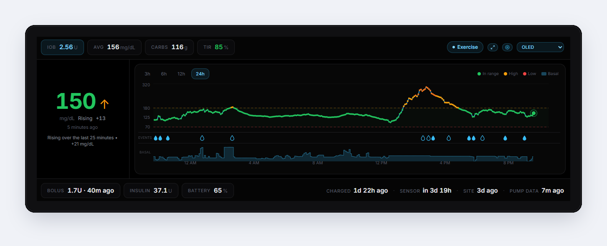</p>

> PumpDash is an independent personal project. It is not affiliated with, endorsed by, or supported by Tandem Diabetes Care or Dexcom. It is not a medical device and is never meant for dosing or treatment decisions.

This repository is a case study. The application source lives in private repositories; this page explains what I built, the engineering problems behind it, and how I approached them.

---

## The problem

My daughter has Type 1 diabetes. She wears a Tandem Mobi insulin pump and a Dexcom G7 sensor. Between the two of them, the information I check all day is split across apps on her phone: blood sugar and its direction, insulin on board, how much insulin is left in the pump, battery, when the site and sensor were last changed, and when the pump last uploaded.

I wanted all of it in one place I could see without picking up her phone. So in May 2025 I started building it. More on that below, in Why I built PumpDash.

## At a glance

| | |
|---|---|
| **Platforms** | Windows and macOS desktop (installers built in CI), iOS (pre-release), Android (in development) |
| **Desktop** | Tauri 2 (Rust) shell, React 19 + TypeScript UI, Python 3.14 FastAPI service bundled as a sidecar |
| **Mobile** | Kotlin Multiplatform shared core, SwiftUI + Swift Charts on iOS, Jetpack Compose on Android |
| **Data** | Dexcom CGM readings and Tandem pump history, read from the user's own accounts |
| **Privacy** | All processing on the device. No PumpDash server, no analytics, credentials in the OS's secure storage |
| **Safety** | Read-only. Estimated values are labeled as estimates. Stale data is dimmed and called out |
| **Tests** | 411 automated tests: 117 desktop backend, 45 desktop frontend, 249 mobile shared core |
| **History** | 104 commits across two repositories, May 2025 to October 2026 |

## Screenshots

**Desktop dashboard.** Built for a small 1280×400 display that sits under my main monitors. Current glucose and trend on the left, a 3/6/12/24-hour chart with bolus, correction, suspend and site-change markers, basal delivery underneath, and pump status along the bottom. The Control-IQ activity mode (here, Exercise) shows in the top bar when it's on.

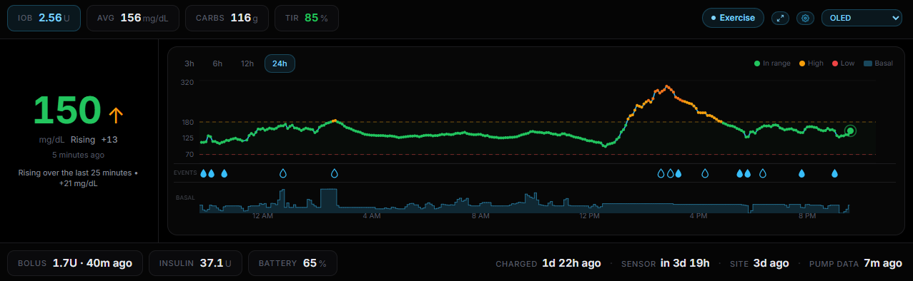

**Running on the secondary display.** A small bar screen under my monitors, so the numbers are there whenever I glance down.

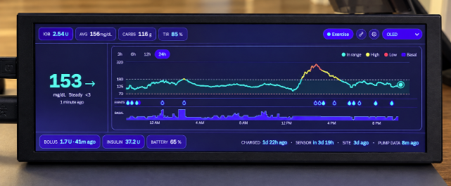

**Glance mode.** One click turns the dashboard into an across-the-room view: the reading, the trend arrow, insulin on board, pump battery and insulin remaining, and how old the pump data is.


**iPhone app.** The same glance-first layout on a phone: the reading and trend up top, pump essentials in the overview pills, and a 3 to 24-hour chart with meals, corrections, suspends and basal delivery. The Pump screen shows exactly where each number came from: when the pump reported, when it uploaded, when PumpDash last checked, and which values are estimated.

<p>
  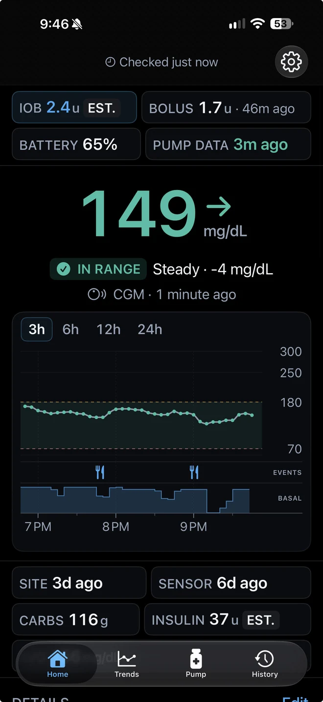
  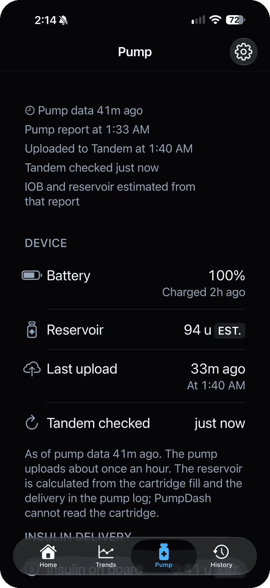
</p>

**Details at a touch.** Meal boluses, corrections and suspends sit on their own row under the chart. Tap a marker for the carbs, units and exact time, then jump straight to every event. Tap a card for the full story behind a value: when the reading was taken, its trend and age, where it came from, and the recent readings behind it.

<p>
  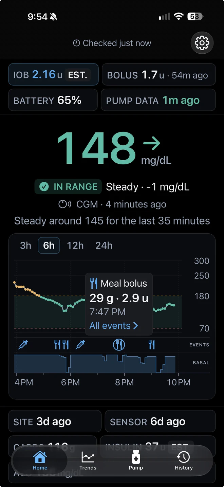
  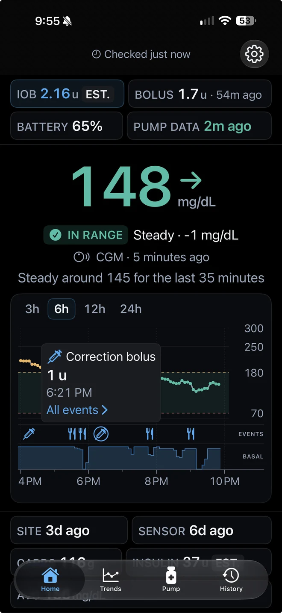
  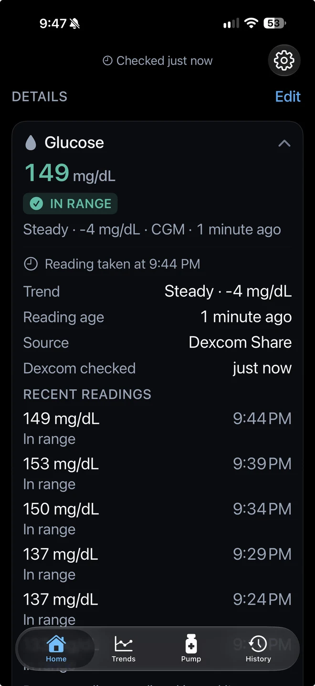
</p>

<details>
<summary><b>More screenshots</b></summary>

**iPhone: trends, insulin delivery, history.** Glucose, events and basal over 3 to 24 hours; insulin on board, basal rate, Control-IQ state, last bolus, site and sensor age; and every meal bolus, correction and suspend, grouped by day.

<p>
  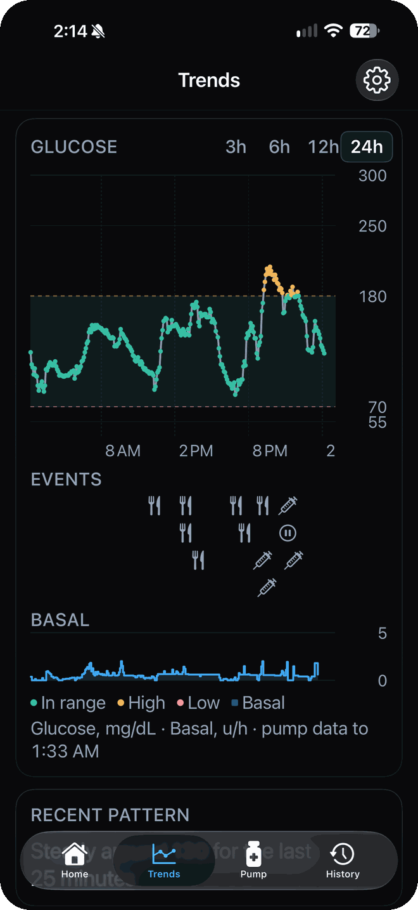
  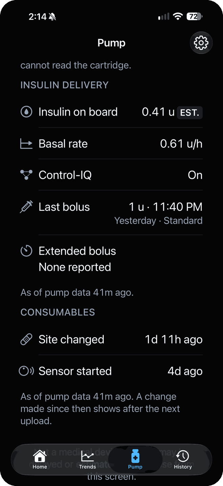
  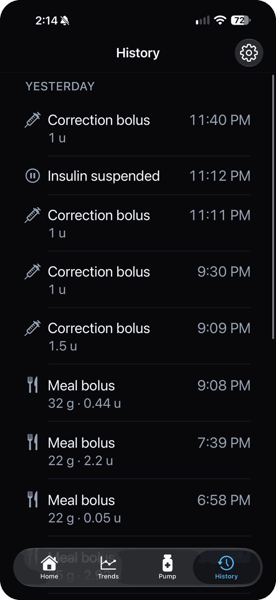
</p>

**iPhone: detail cards.** Every value has its own card, and Edit reorders or hides them. Estimated values carry an EST. badge, and when pump data is overdue the sync card turns amber and says Late.

<p>
  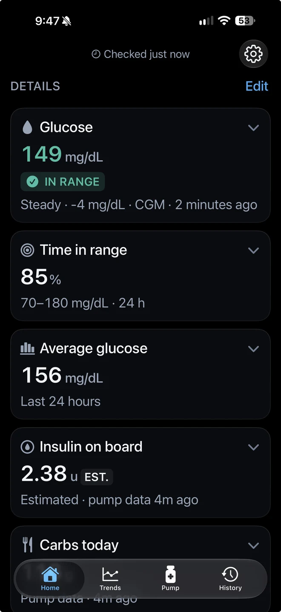
  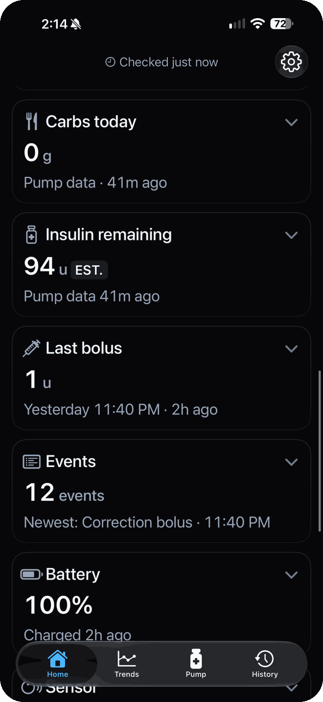
  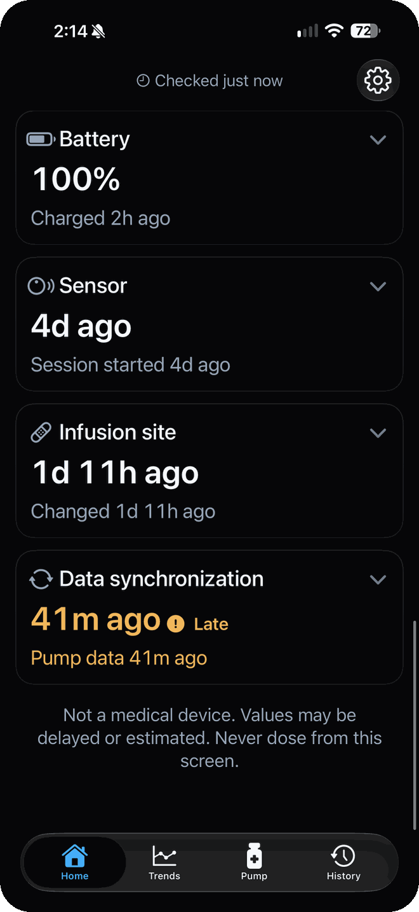
</p>

**Settings** cover chart overlays, the site-change display and the live indicator, plus connection health and disconnecting accounts.

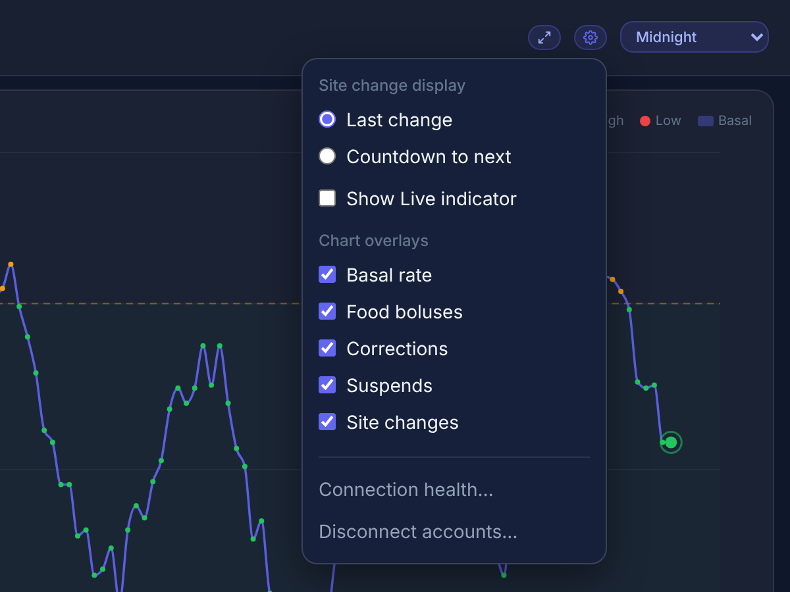

</details>

## Engineering highlights

- **Undocumented binary records.** The first version decoded raw pump event records that have no official documentation, using jwoglom's open-source [tconnectsync](https://github.com/jwoglom/tconnectsync) as a reference, and checked the decoded values against what the pump itself displayed. When the upstream service changed in 2026 and began returning structured events, I migrated to them and retired the binary decoder.
- **Two sources, two rhythms.** CGM readings arrive every five minutes; pump data arrives only when the pump uploads: about every 5 minutes with Sugarmate connected to Tandem Source, roughly hourly without it. PumpDash learns each pump's upload rhythm, checks right when an upload is due, and backs off when it's late.
- **Estimates between uploads.** Insulin on board is projected forward on a published insulin-activity curve and insulin remaining at the current basal rate. Both are marked as estimates and snap back to the pump's own values as soon as fresh data lands.
- **Pump clocks drift.** They can also miss a daylight-saving change. PumpDash maps the pump's clock onto real time using the UTC time attached to the newest event, so elapsed-time math doesn't skew.
- **One source of truth on mobile.** All data logic, math and display formatting live in a Kotlin Multiplatform module. iOS and Android only draw what it hands them, so the two apps always show the same values and the same warnings.
- **Local-first security.** The desktop UI talks to its local service over a WebSocket that requires a random per-launch token and rejects requests from web pages. Logs redact tokens and session identifiers. Nothing leaves the device except requests to the two data services.

## Project timeline

Dates come from the commit history of the two private repositories and my integration notes.

| When | Milestone |
|---|---|
| May 2025 | First commit. Python scripts decode pump event records; first desktop GUI |
| Aug 2025 | Data manager rewrite; tracking pump upload timing to find its pattern |
| Mar 2026 | Rebuilt as a Tauri + React desktop app with a Python sidecar; credentials in the OS keychain; IOB estimates between uploads; CI builds Windows and macOS installers |
| Mar to Aug 2026 | Tandem Source retires its old report endpoints and moves to a new API that returns pump history as structured JSON events. Decoding raw binary records is no longer necessary |
| Aug 2026 | Pump client moved to the new Tandem Source API and the binary decoder retired (v1.0.1). Versions 1.0 to 2.0: first-run setup wizard, Control-IQ state, chart overlays, themes, glance mode |
| Aug to Oct 2026 | Mobile: Kotlin Multiplatform core, SwiftUI iOS app, Compose Android app |
| Oct 3, 2026 | Tandem Source starts rejecting the event filter on pump-log requests. The client now pulls all events and filters them on the device, with incremental pulls to keep traffic down |
| Oct 2026 | Desktop hardening: per-launch token and origin guard on the local service, hash-pinned and audited dependencies, redacted logs; polling learns each pump's upload rhythm. Pre-release review of the mobile app |
| Oct 14, 2026 | With Sugarmate connected to Tandem Source, the pump uploads every 5 minutes instead of hourly. Desktop and mobile polling now lock onto that 5-minute rhythm, and the freshness limits tighten to match |

## Reliability and testing

Results below were produced on October 13, 2026, from the current working trees, in a clean environment.

| Suite | Result |
|---|---|
| Desktop backend (pytest, Python 3.14) | 117 passed, 78% line coverage of application code |
| Desktop frontend (Vitest) | 45 passed across 6 files |
| Desktop static checks | ESLint clean, TypeScript build clean in strict mode |
| Mobile shared core (Kotlin Multiplatform, JVM target) | 249 passed across 15 test classes |
| Dependency audit | pip-audit: no known vulnerabilities in the locked Python packages. npm audit: 0 vulnerabilities |

## Roadmap

| Status | Feature |
|---|---|
| In progress | **Demo Mode for the mobile app.** Simulated data on iOS and Android, matching the desktop's Demo Mode, so the app can be explored without accounts and shown without real health data |
| Planned | **Apple Watch app.** The current reading, trend and pump essentials on the wrist |
| Planned | **CarPlay widget.** A glanceable reading on the car's display |

## The details

<details>
<summary><b>Why I built PumpDash</b></summary>

### The view I didn't have

My daughter was diagnosed with Type 1 diabetes. Today she wears a Tandem Mobi insulin pump and a Dexcom G7 continuous glucose monitor. But the information I need as her parent is spread across apps on her phone, and the questions I ask myself many times a day don't line up with how those apps are organized:

- What's her blood sugar right now, and which way is it moving?
- How much insulin is still working?
- How much is left in the pump, and does it need charging?
- When did we last change her site? When does the sensor expire?
- How old is the pump data I'm looking at?

To answer them I had to pick up her phone and open more than one app. I spend a large part of the day at my computer, and I wanted the answers sitting right there, readable at a glance, without asking her for her phone.

I looked for something that did this and couldn't find what I wanted, so I built it.

### From a script to three platforms

**May 2025.** The first version was a handful of Python scripts. The pump's history came back as raw binary records with no official documentation, so the first real problem was figuring out what the bytes meant. Thanks to jwoglom's [tconnectsync](https://github.com/jwoglom/tconnectsync) as a reference, I was able to decode the information into something useful. Battery level took the most attempts. Within a few days I had a small desktop window showing the last cartridge change, insulin remaining, battery and the last upload time, next to live CGM readings.

**August 2025.** I rewrote the data handling and started logging when the pump uploaded, because pump data only arrives when the pump syncs, and I wanted to know when to look for it.

**March 2026.** Rewrote the basic Python code to use a Tauri desktop shell, a React interface and a bundled Python background service, with automated builds for Windows and macOS. It added credentials in the operating system's keychain, estimates of insulin on board between pump uploads, per-dose tracking and the first themes. The layout is designed for a small 1280×400 screen that sits under my monitors.

**August 2026.** After a few months away, I came back with a list of ideas and added in a bunch of features like a first-run setup wizard that verifies logins, Control-IQ status, chart overlays for boluses, suspends and site changes, more themes and settings, and glance mode. The pump data source also changed upstream that summer, and I migrated from decoding binary records to the structured events it now returned.

**August to October 2026.** I wanted the same view on a phone, so I built a mobile version around a shared Kotlin Multiplatform core with native SwiftUI and Jetpack Compose interfaces. Before calling it 1.0, I put it through a structured pre-release review covering medical-data integrity, security, accessibility, performance and third-party terms.

</details>

<details>
<summary><b>Engineering case study</b></summary>

This section covers the problems that took the most thought. It describes approaches, not access details.

### 1. Origin

I started PumpDash on May 4, 2025, to answer one question without picking up my daughter's phone: what's going on with her pump and her sugar right now? Two constraints came out of it and shaped every decision after:

- A wrong or stale number is worse than no number.
- Her health data shouldn't pass through anyone else's server, including mine.

### 2. Making sense of undocumented binary records

**Problem.** The pump's event history originally came back as a block of binary records with no published format. I needed specific values out of it: when the cartridge was last filled, how much insulin was left, battery level, the last upload time.

**Approach.** I used jwoglom's open-source [tconnectsync](https://github.com/jwoglom/tconnectsync) project as a reference for the record format, then wrote my own decoder for the fields I needed:

1. **Typed functions per event type**, so a correct field never had to be re-derived and a wrong one was isolated to a single place.
2. **Checked against ground truth.** I compared decoded values with what the pump's own screen and the official app showed at known times, across several days, before trusting them.

**Battery was the hardest.** The raw values didn't map linearly to the percentage the pump displayed. It took three rounds over two days in May 2025 to settle on a lookup that matched, and another revision in August 2025. In August 2026, with the structured event format, I switched to the pump's own fuel-gauge percentage and kept the earlier voltage-based mapping only as a fallback for records that don't carry it.

**Some values are never logged directly.** Carbohydrates were the clearest example: this pump model never writes the standalone "carbs entered" event, so the daily carb total has to be reconstructed from the bolus calculator's records instead. Insulin remaining is similar: it's calculated from the last cartridge fill minus everything logged as delivered since, and it's floored at zero rather than going negative.

**What changed.** In mid-2026 the upstream service changed without notice and began returning structured events. I migrated in August 2026 and retired the binary decoder. That migration meant reworking the pump client directly, so right afterwards I put each data source behind a provider interface (see Cross-platform architecture below). The next upstream change should replace one component, not ripple through the app.

### 3. Normalizing two sources that run on different clocks

**Problem.** Glucose comes from the CGM service every five minutes with UTC timestamps. Pump events arrive in batches, one per pump upload (about every 5 minutes with Sugarmate connected, roughly hourly without it), stamped with the pump's own local clock, which can drift, can be set by hand, and can miss a daylight-saving change. The pump also relays its own copy of CGM readings, so the same sample can arrive twice from two sources with slightly different times.

**What I learned the hard way.** In March 2026 I made seven timestamp fixes in two days chasing a four-hour offset, and settled on naive pump-local times as a stopgap. By October 2026 that had become a set of rules:

- Every reading is normalized to one shape as it enters the system.
- Displayed times use the service's UTC time, with an explicit offset, whenever it provides one. A "UTC" time that arrives without an offset is discarded rather than guessed at. Only when no UTC time exists is the pump's own clock shown.
- Pump-clock times are kept separate and used only for pump-side math.
- Conversion to local time happens only at the edge, when something is drawn.
- Elapsed-time math for the pump runs on the pump's own clock, mapped onto real time through the UTC time the service attaches to the newest event. A pump clock that is off by an hour, or missed a DST change, doesn't skew "how long ago".

**Deduplication.** Pump events are keyed by the pump's sequence number, so overlapping fetches merge cleanly. Glucose readings are keyed by source and time: if the pump's relayed copy lands within the same sample window as a direct CGM reading, the CGM reading wins and the copy is dropped. Pump readings dated more than two minutes in the future (a pump clock running ahead) are ignored so they can't hold the main number hostage.

**Fallback.** When the CGM feed is missing or older than 12 minutes, the pump's relayed readings fill in, and the interface says where the number came from.

**Trend from the merged history.** Because the displayed reading can come from either source, PumpDash computes the trend arrow and rate from the merged history instead of trusting each source's own arrow. The rules are tested: the arrow never points against the delta shown next to it, a single noisy step can't swing a steady run, and the arrow shows "?" when there isn't enough recent history.

### 4. Estimating between uploads

**Problem.** The pump reports insulin on board (IOB) only in its periodic logs, which arrive only when it uploads: about every 5 minutes with Sugarmate connected, roughly hourly without it, and not at all while the phone is out of range. A dashboard that shows a 55-minute-old IOB as if it were current is misleading, but making up a number is worse.

**Approach.** The estimator projects the pump's last reported state forward to now:

- **Bolus insulin decays on a published insulin-activity curve** (the exponential model used by the open-source Loop and Tidepool projects, 300-minute duration, 75-minute peak), applied to each dose individually from its own delivery time.
- **The pump's IOB is split into two parts.** Insulin from boluses decays on the curve. The remainder comes from automated basal adjustments, which Control-IQ actively maintains, so it's held steady while basal is running and decays only while delivery is suspended. My first version decayed the whole number and watched IOB collapse toward zero while the pump itself was reporting it rising. Splitting it fixed that.
- **Capped by the pump's own number.** If the curve says more pre-snapshot bolus insulin should remain than the pump reported, that part of the projection is scaled down to the pump's value.
- **Boluses delivered after the pump's last IOB snapshot** are added on top, and an extended bolus in progress counts in full.
- **Insulin remaining** is projected down at the currently commanded basal rate, and holds steady while delivery is suspended.

**Guardrails.**

- The pump's own numbers are shown as reported until its newest report is more than 10 minutes old. Only then does the projection take over.
- Every estimated value is flagged as estimated and labeled that way in the interface.
- The estimate is always computed from the raw pump state, never from a previous estimate, so nothing decays twice.
- When fresh data arrives, the display snaps back to the pump's own values.
- On mobile, an IOB estimate is withheld entirely once the underlying pump data is more than 6 hours old, past the 5-hour insulin action time.
- If the projection throws for any reason, the pump's own last-reported numbers are shown instead of nothing.

### 5. Polling that respects the upstream service

**Problem.** Checking for pump data too often wastes the user's cell phone battery and puts unnecessary load on a service I don't control. Checking too rarely means stale data. The pump uploads about every 5 minutes with Sugarmate connected and roughly hourly without it, never on an exact schedule, and it also makes uploads that contain nothing new.

**Evolution.** From March 2026 the desktop polled every five minutes. In October 2026 I replaced that with a schedule that learns each pump's rhythm, and on October 14 retuned it for 5-minute uploads:

- The rhythm is learned from recent gaps between uploads, measured with the service's own upload timestamps so poll timing can't skew the statistics. The median of the newest gaps sets a rough period, so one odd gap doesn't throw it off; the gaps that fit it are then averaged for the exact period and how early or late uploads tend to land.
- Only uploads that bring new events count. The pump also uploads at profile time-segment boundaries with nothing new, and counting those would reset the clock just before a real upload.
- On a 5-minute rhythm, checks cluster in the window where the next upload is learned to land, 45 to 90 seconds apart, so each upload is usually caught within a minute. If it's late, checks back off to every few minutes, and to every 10 minutes once the pump has been offline for 2 hours (phone out of range, overnight).
- When uploads slow down (Sugarmate disconnected, say), PumpDash checks twice where the next 5-minute upload would land, then every 5 minutes. It never waits out an hourly gap, so a return to 5-minute uploads is picked up right away.
- A cheap status check runs first; the heavier event download happens only when the status says something new arrived.

**Mobile:** The same ideas live in one tested `PollingPolicy` component, with hard rules instead of conventions: a five-minute floor that holds even after a resume, every request has a timeout, failures get exponential backoff with jitter, a `Retry-After` header is honored, repeated failures open a circuit breaker, and a rate-limit response slows polling permanently until the next sign-in.

### 6. Cross-platform architecture

**Desktop.** A Rust/Tauri shell hosts a React interface and launches a Python service as a bundled sidecar. The data rules (providers, normalization, estimation, polling) live in Python, behind two small interfaces: `CGMProvider` and `PumpProvider`. Each has a real implementation and a simulator for Demo Mode. The server and UI don't know which one they're talking to, so Demo Mode needs no special cases, and a future change to either data source stays inside one class.

**Mobile.** A Python sidecar can't ship on a phone, and a web view would mean keeping two copies of every rule. So for mobile I moved the rules into a Kotlin Multiplatform module: providers, polling policy, the event interpreter, the estimator, the glucose math, and the display model. That last part matters most. The shared core doesn't just hand the platforms data; it hands them every number already formatted and every color tier already decided. SwiftUI and Compose only draw it, so iOS and Android always show the same values, labels and warning levels. The same module runs the test suite on the JVM, which means the full shared test suite runs on a Windows PC with no phone or Mac attached.

### 7. Security and privacy

Highlights:

- **No PumpDash server.** Data goes directly from the two services to the user's device and nowhere else. No analytics, no crash-reporting SDKs.
- **Credentials in the OS credential store**: Windows Credential Manager or macOS Keychain on desktop, Keychain on iOS, Keystore-encrypted storage on Android. Never in a plain file.
- **The local service is locked down.** The desktop shell generates a random token at each launch and passes it to the Python service; every HTTP request and the WebSocket must carry it. A separate guard rejects requests that come from a web page, since a browser would otherwise let any open site talk to a localhost server. Only the app's own origins are allowed.
- **Logs are safe to attach to a bug report.** A redacting formatter strips tokens, authorization codes and session identifiers before anything is written.
- **The service can't outlive the app.** If the desktop app crashes, the service notices its input pipe closing and shuts down, rather than holding the port with a token the next launch doesn't know.

### 8. Reliability

| Failure | What PumpDash does |
|---|---|
| Pump upload is late | Polling tightens around the expected time, then backs off. IOB and insulin remaining become labeled estimates after 10 minutes, pump values dim after 20 minutes and show their age, and after two missed uploads in a row the top bar says "Disconnected - Stale Data" |
| CGM feed goes quiet | After 12 minutes the reading is marked stale and the pump's relayed readings take over if available |
| Network drops | Requests time out instead of hanging. Errors back off per endpoint. The last good values stay on screen, marked with their age |
| Session expires or is revoked | Recovers automatically where possible (tested); otherwise the user is asked to sign in again |
| Password rejected | The user is told, and the saved password is retried only twice (after 30 minutes, then 2 hours) before polling stops, so a changed password can't lock the account |
| Rate limited | Every endpoint pauses for the `Retry-After` the service gave |
| Local service unreachable | The UI shows "Connecting…", dims values, marks the reading "not connected", and reconnects on its own |
| Slow UI client | The service drops a client that can't take a message within 2 seconds instead of stalling every update |
| Bad or missing values | Wrong-type, non-finite or out-of-range values are dropped at the boundary. Missing values render as `---`, never as 0 |
| Pump clock changed | A clock-change event forces a full resync; event order survives a clock set backwards |
| Frozen build missing a module | CI starts the packaged binary on simulated data, checks health and the auth guard, and shuts it down before any installer is built |

### 9. Lessons learned

**Make every timestamp say which clock it's on.** I lost days to timezone bugs with one root cause: times without an explicit offset, read as UTC in one place and as local time in another.

**"Unknown" is a value.** Zero carbs and "no carb data yet today" are different facts. The mobile core models unknown explicitly from the start, and the tests check that missing values render as dashes, never zeros.

**Write the rules down as code, with tests.** Polling etiquette, freshness thresholds and estimate guards were conventions on desktop. On mobile they're components with tests, and that caught mistakes the conventions didn't.

**Review before release, not after.** A structured pre-release review of the mobile app in October 2026 found real problems: signing out didn't clear the previous account's cached data from the screen and disk, the mmol/L setting converted only the main number, and some error messages could show raw server responses. Most are now fixed, with new tests for the sign-out and session cases; the rest are scheduled before 1.0.

</details>

<details>
<summary><b>Architecture</b></summary>

PumpDash has two codebases: a desktop app (Windows, macOS) and a mobile app (iOS, Android).

### Desktop

| Layer | Technology | Responsibility |
|---|---|---|
| Shell | Tauri 2 (Rust) | Window, installer, launching and stopping the local service, generating the per-launch access token |
| Interface | React 19, TypeScript, Recharts, Tailwind CSS | Dashboard, chart, glance mode, settings, setup wizard, connection health |
| Local service | Python 3.14, FastAPI, Uvicorn, bundled with PyInstaller | Data providers, polling, normalization, estimation, credential storage, logging |
| Credential storage | `keyring` (Windows Credential Manager, macOS Keychain) | Account logins, never written to a file |

### Mobile

| Layer | Technology | Responsibility |
|---|---|---|
| Shared core | Kotlin Multiplatform, Ktor, kotlinx-serialization, kotlinx-datetime, coroutines and Flow | Everything that isn't a pixel |
| iOS | SwiftUI, Swift Charts | Screens only |
| Android | Jetpack Compose | Screens only |
| Secrets | Keychain (iOS); AES-GCM with a non-exportable Android Keystore key (Android) | Tokens and credentials |

#### The shared core

```
shared/
  model/       GlucoseReading, PumpStatus, DashboardSnapshot
  provider/    CgmProvider and PumpProvider contracts
  net/         PollingPolicy: when a provider is allowed to make a request
  auth/        token storage contracts, with platform implementations
  tandem/      pump client, event interpreter, between-upload estimator
  dexcom/      CGM provider
  math/        glucose zones, trend, time-in-range, summaries, time formatting
  dashboard/   DashboardEngine, DisplayModel, PumpDashStack (the one object each app holds)
```

`PumpDashStack.refresh()` polls whatever the polling policy allows, never throws, and returns a `DisplayModel`: every number already formatted, every color tier and freshness level already decided, every "unknown" already a dash. The iOS and Android apps render it and nothing more. That's the design decision that keeps two native apps consistent with one set of rules.

The core is UI-free on purpose. The iOS app, the Android app and the test suite all consume exactly the same module, and the tests run on the JVM, so the full suite runs on a Windows PC with no phone or Mac.

</details>

<details>
<summary><b>Privacy and security</b></summary>

PumpDash handles a child's health data and the logins to two medical-data accounts. The design goal is simple: that data should go from the vendor's service to the user's own device and nowhere else.

### What PumpDash stores, and where

| Data | Desktop | iOS | Android |
|---|---|---|---|
| Account credentials | OS credential store (Windows Credential Manager, macOS Keychain) | Keychain | Encrypted with AES-GCM under a non-exportable Android Keystore key |
| Glucose and pump data | In memory; a pump upload-timing log in a PumpDash data folder (AppData on Windows, the home folder on macOS) | Snapshot in app storage with complete file protection, excluded from backups | Snapshot encrypted under a Keystore key, in no-backup app storage |
| Logs | Local log rotated at 1 MB with one backup kept, secrets redacted | None | None |
| Settings | Local app storage | App storage | App storage |

**What leaves the device:** requests to Dexcom and Tandem Source, and nothing else. There is no PumpDash server, no analytics, no crash-reporting service and no third-party SDK on iOS. The iOS privacy manifest declares no tracking and no collected data.

</details>

<details>
<summary><b>Development history</b></summary>

PumpDash lives in two private repositories: the desktop app and the mobile app. Every date below comes from their commit history.

### Phase 1: Scripts and binary records (May 2025)

May 4 and 5.

- Fetched the pump's event history and decoded its binary records, using jwoglom's [tconnectsync](https://github.com/jwoglom/tconnectsync) as a reference.
- Battery percentage took three rounds before the decoded values matched the pump.
- Pulled live CGM readings, first from the vendor's developer sandbox for testing, then from the real feed.
- First GUI showing last cartridge change, insulin remaining, battery, and last pump upload, then moved it to PySide6.

### Phase 2: Understanding upload timing (August 2025)

- Loaded seven days of history at launch.
- Split data management into its own module.
- Logged pump uploads to find their pattern. That log is the origin of the upload-aware polling that shipped in October 2026.
- Refined battery percentage, last bolus, carbs and upload-time tracking.

### Phase 3: A real desktop application (March 2026)

March 19 to 21.

- Rebuilt as a Tauri 2 desktop app with a React and TypeScript interface, the Python code running as a bundled sidecar.
- First between-upload estimates: per-dose insulin on board on the Loop/Tidepool insulin curve, extended bolus handling, insulin remaining.
- Credentials moved into the OS keychain.
- GitHub Actions building Windows and macOS installers, with the frozen Python service bundled.
- Two days of timezone work: pump times are local to the pump, CGM times are UTC, and the fix needed more than one attempt (see the Engineering case study).

### Phase 4: 1.0 to 2.0 (August 2026)

August 16 and 17, after a few months away from the project.

- **Before 1.0:** first-run setup wizard with verified logins, installer directory choice, desktop shortcut.
- **v1.0.0:** first 1.0 release.
- **v1.0.1:** the upstream data source had changed, so the pump client moved from binary decoding to structured events. Licensed under PolyForm Noncommercial.
- **v1.1.0:** battery from the pump's fuel gauge with the voltage table as fallback; Control-IQ state and sleep/exercise modes; between-upload estimates use the commanded basal rate; chart thresholds follow the pump's own high/low settings; pump CGM readings as a fallback when the CGM feed is missing or stale.
- **v1.2.0:** IOB estimate split into bolus and basal parts; chart overlays for basal, boluses, corrections, suspends and site changes; sensor countdown; site-change reminders; carbs reconstructed from bolus-calculator events.
- **v2.0.0:** themes, customizable settings, provider interfaces for each data source, glance mode. Right after: trend computed locally from merged history, app icons for Windows and macOS, a fix for the chart lagging the current reading.

The same week, on August 17, the **mobile repository** started: a Kotlin Multiplatform shared core with models, provider contracts, glucose math and tests from the first commit.

### Phase 5: Mobile (September to October 2026)

- **Sep 2:** iOS support added, with the first SwiftUI screens.
- **Sep 3:** dropped the planned widgets and lock-screen views.
- **Oct 11:** first iOS test build; sign-in and keychain fixes.
- **Oct 12:** UX overhaul that puts pump information first, movable cards, and new layout and colors for stale pump data.
- **Oct 12:** structured pre-release review of the mobile app covering medical-data integrity, security, accessibility, performance and third-party terms. Most of its code findings are already fixed.

### Phase 6: Desktop hardening (October 2026)

- Per-launch token and origin guard on the local service.
- The service exits when the app does, even after a crash.
- Hash-pinned Python lockfile, Dependabot, and known-vulnerability audits in CI.
- Frozen-binary smoke test in CI before installers are built.
- Redacting log formatter.
- Upload-aware polling that learns each pump's rhythm.
- Larger UI elements for the small display.

</details>

## Source availability

The PumpDash source code is private. The pump data comes from a consumer account with no public developer API. I'm happy to walk through the code in an interview or technical review.

## Disclaimer

PumpDash is not a medical device. Information it displays may be delayed, incomplete, estimated, or unavailable. Never use it to calculate insulin doses or make treatment decisions; rely on the pump, CGM, meter, official manufacturer apps, and your healthcare team. Tandem, Mobi, Control-IQ, Tandem Source, Sugarmate, Dexcom and G7 are trademarks of their respective owners.

## Themes

Six themes, including a true-black OLED theme and a light theme.

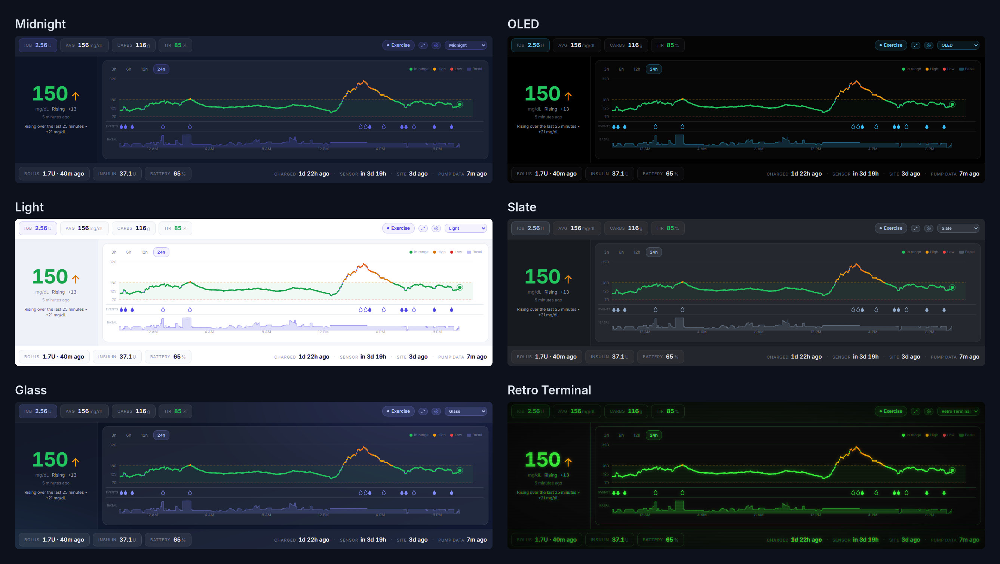
